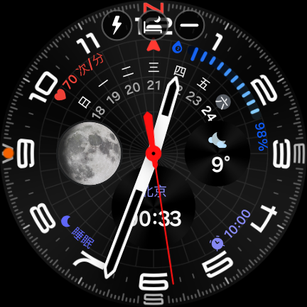

# vivo TWS Watch Control

在 **Wear OS 手表**上直接控制 **vivo / iQOO TWS 耳机**的降噪模式与电量查询——不依赖手机，手表通过经典蓝牙 RFCOMM 直连耳机发送 vivo 私有 GAIA 指令。耳机可同时保持与手机的音频连接（双设备连接）。

> 本项目由 AI 辅助完成开发与实机调试，协议基于社区公开逆向成果（见[致谢](#-致谢)）。

## ✨ 功能

- **噪声控制三选一**：降噪开 / 降噪关 / 通透，当前模式高亮（vivo 官方 App 风格卡片式 UI）
- **三段电量**：左耳 / 右耳 / 充电盒百分比 + 彩色进度条（绿正常、红低电量、⚡充电中、`--`未上报）
- 切后台自动断开省电，回前台自动重连；耳机主动推送的电量变化实时更新


## 📱 支持的手表

- **系统要求**：Wear OS 3 及以上（Android 11+ / API 30+），带经典蓝牙的手表
- **实测**：三星 Galaxy Watch7（SM-L300，Wear OS / Android 16）
- **理论兼容**：Galaxy Watch4/5/6、Pixel Watch、TicWatch 等其他 Wear OS 手表（未逐一验证）

## 🎧 支持的耳机

vivo / iQOO TWS 家族共用一套 GAIA 私有协议，本 App 内置三套机型线格式差异配置，按蓝牙设备名自动选择，未知机型走家族默认配置：

| 耳机 | 状态 |
| --- | --- |
| vivo TWS Air3 Pro | ✅ 实机验证（Galaxy Watch7 上全功能） |
| vivo TWS 3e | ✅ 协议文档验证（配置来自公开逆向文档） |
| vivo TWS 4 / TWS 3 系列 / iQOO TWS 系列等其他家族机型 | ⚡ 同族协议，理论兼容，未逐一实测 |

非 vivo 家族耳机不受支持（协议不同，如 AirPods / Marshall / Sony 等）。

## 📸 截图



## 🚀 快速开始

1. **手表与耳机完成蓝牙配对**：手表 设置 → 连接 → 蓝牙 → 配对新设备（耳机放回充电盒再开盖进入配对模式）。RFCOMM 安全通道要求已配对。
2. 安装 APK（任选其一）：
   - 从 [Releases](../../releases) 下载 `vivo-tws-watch-debug.apk`，`adb install -r` 装到手表
   - 或自行构建：Windows 下依次运行 `scripts\setup-env.bat`（首次，装 JDK17 + Android SDK，约 300MB）→ `scripts\build.bat`（免 Gradle，一键出包）
3. 手表上打开"vivo 耳机控制"，授权附近设备权限即用。

## 🤖 AI 一键傻瓜式操作

不会搭环境也没关系——把下面的提示词整段复制给任意 AI 编程助手（Claude Code / Cursor 等），它会替你完成下载仓库、搭环境、编译、装进手表的全过程：

```text
请帮我把 GitHub 项目 hdzw1155/vivo-tws-watch-control（vivo/iQOO TWS 耳机的
Wear OS 手表控制器）装到我的 Wear OS 手表上，步骤：
1. git clone 该仓库（若直连失败请重试或换镜像）。
2. 检查本机有无 JDK17 与 Android SDK；没有就参考仓库 scripts/setup-env.bat
   自动安装（Windows 下：Microsoft JDK 17 装到 %USERPROFILE%\android-tools，
   Android 命令行工具装到 %LOCALAPPDATA%\Android\Sdk，再装
   platforms;android-34 和 build-tools;34.0.0）。
3. 运行 scripts/build.bat 编译出 vivo-tws-watch-debug.apk（免 Gradle）。
4. 手表开启 开发者选项 → ADB 调试 / 无线调试，用 adb connect 连上手表后
   adb install -r 安装。
5. 先在手表蓝牙设置里与耳机配对，再打开手表上的"vivo 耳机控制"，
   验证降噪三态切换和电量显示，出问题按仓库 README 排查。
注意：.bat 脚本需要 CRLF 换行和 chcp 65001，路径含空格时注意加引号。
```

## 🔧 工作原理（思路整理）

**为什么手机 App 能控、手表官方不能？** vivo 耳机的降噪/电量控制走的是 vivo 私有协议（官方"vivo 耳机"App 实现），Wear OS 上没人做这个 App，所以只能自己写一个协议客户端。

**协议要点**（全部来自社区公开逆向，非官方）：

- **传输层**：经典蓝牙 RFCOMM（不是 BLE GATT）。SDP 服务 UUID `00000837-d102-11e1-9b23-00025b00a5a5`（高通 GAIA 框架），SDP 发现失败时退回固定 channel 13
- **帧格式**：`FF | VERB | 00 | LEN | VENDOR(2字节,大端) | CMD(2字节,大端) | PAYLOAD(LEN字节)`
- **厂商 ID**：握手用高通通用 `0x000A`，vivo 命令空间 `0x001B`
- **命令表**：

| 命令 | 功能 | 备注 |
| --- | --- | --- |
| `0x0300` / `0x8300` | 握手 / 应答 | 请求 VERB=4 |
| `0x0207` / `0x8207` | 电量查询 / 上报 | payload `00 L R C 充电标志`，0xFF=未上报，充电标志 bit0/1/2 对应左/右/盒 |
| `0x0230` / `0x8230` | 降噪状态查询 / 上报 | payload `00 mode 效果 效果` |
| `0x0130` / `0x8130` | 降噪设置 / 确认 | payload `mode 尾缀`，mode：`00`降噪 / `01`关 / `02`通透 |

- **机型差异**（设置命令的 VERB 与尾缀）：

| 机型 | VERB | 查询载荷 | 设置尾缀 | 来源 |
| --- | --- | --- | --- | --- |
| Air3 Pro | 3 | 空 | `04 00` | 实机抓包 |
| TWS 3e | 3 | 空 | `03` | 公开文档 |
| 家族默认 | 4 | `00` | `03 01` | 公共画像 |

- **架构决策**：手表只做"遥控器"——不开音频通道，仅维持一条 RFCOMM 控制连接（连上即查状态，切后台即断开），耳机与手机的多点音频连接不受影响；纯 Java + 系统控件零第三方依赖，免 Gradle 用 aapt2/javac/d8 手工构建，仓库里两个脚本一键复现。

协议为逆向所得，耳机固件升级后命令可能变化；失效时可用官方 App 抓 HCI 日志（btsnoop）按控制变量法重新比对验证。

## 🙏 致谢

本项目的协议知识全部站在前人肩膀上，向以下开源项目与作者致敬：

- **[silverpoetry/HyperEars](https://github.com/silverpoetry/HyperEars)** — vivo/iQOO TWS 家族协议画像、Air 3 Pro 实机抓包记录与三套机型线格式配置（WireConfig），本 App 的多机型参数直接源自该项目
- **[Zhaoyi-ya/TWS-Pods-PC](https://github.com/Zhaoyi-ya/TWS-Pods-PC)** — vivo TWS 3e 私有协议逆向文档（vivo/PROTOCOL.md），含 btsnoop 抓包方法论
- **[Star-ZER0/Pods-Protocol-Reverse](https://github.com/Star-ZER0/Pods-Protocol-Reverse)** — vivo TWS 公共协议画像（家族默认参数来源）
- Qualcomm **GAIA** 框架的公开文档与 [c0ffee-audio/marshall-protocol](https://github.com/c0ffee-audio/marshall-protocol) 等项目提供的 GAIA 帧格式参照

本项目为个人兴趣作品，与 vivo/三星/高通无关；逆向协议仅用于个人设备的学习研究，请勿用于商业用途。

## ⚠️ 免责

本 App 只发送降噪/电量类只读与状态切换指令，不含固件写入、恢复出厂等危险命令；最坏情况是 App 连不上或无响应，不会损坏耳机。使用即视为自担风险。
