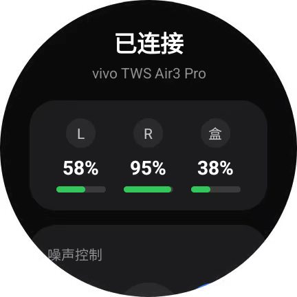
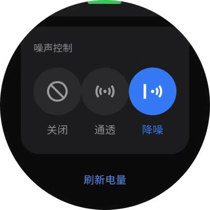

# vivo TWS Watch Control

在 **Wear OS 手表**上直接控制 **vivo / iQOO TWS 耳机**的降噪模式与电量查询——不依赖手机，手表通过经典蓝牙 RFCOMM 直连耳机发送 vivo 私有 GAIA 指令。耳机可同时保持与手机的音频连接（双设备连接）。

- 个人免费开源，与 vivo 官方无关
- 不收集、不上传任何数据
- 按"现状"提供，兼容性可能随耳机固件更新而变化

> ⚠ **非官方、未获授权**：本项目为非商业个人学习研究作品，未获 vivo / 三星 / 高通 / 蓝牙技术联盟任何授权与关联认证；文中出现的第三方商标仅作兼容性说明（名义性使用），归各自所有者所有。协议基于社区公开逆向成果（见[致谢](#-致谢)），由 AI 辅助完成开发与实机调试。

## ✨ 功能

- **噪声控制三选一**：降噪开 / 降噪关 / 通透，当前模式高亮（vivo 官方 App 风格卡片式 UI）
- **三段电量**：左耳 / 右耳 / 充电盒百分比 + 彩色进度条（绿正常、红低电量、⚡充电中、`--`未上报）
- **空间音频开关（开发者设置·实验性·开发中）**：**暂无实际效果，功能在开发中**，请勿依赖；指令链路已打通（首次启用弹风险确认框，记住后不再打扰），仅限 vivo TWS Air3 Pro 适配；**开发者设置默认隐藏，每次启动重新关闭，连点 5 下"开发者设置"入口开启**
- 切后台自动断开省电，回前台自动重连；耳机断开(开关机/超距)时电量显示自动清空并每 5 秒自动重连，回来自动刷新；页面内也可手动刷新


## 📱 支持的手表

- **实测**：三星 Galaxy Watch7（SM-L300，Wear OS / Android 16）——本项目只在这一台手表上做过实验
- 其他 Wear OS 手表：满足 Wear OS 3+ 且支持经典蓝牙理论上可用，但本项目未验证，不做保证

## 🎧 支持的耳机

vivo / iQOO TWS 家族（TWS 3 代起）共用一套 GAIA 私有协议，App 按蓝牙设备名自动选择机型配置（含 `air3` → Air3 Pro 配置；含 `3e`/`tws3` → TWS 3e 配置；其余 → 家族默认 v4，即 TWS 4 的实测配置）：

| 支持度 | 机型 | 依据 |
| --- | --- | --- |
| ✅ 实机验证 | **vivo TWS Air3 Pro** | 本项目在 Galaxy Watch7 上全功能实测（降噪三态 + 电量） |
| ✅ 来源项目真机验证（**非本项目实测**） | **vivo TWS 3e**、**TWS 4 / TWS 4 Hi-Fi**、**TWS 5** | [TWS-Pods-PC](https://github.com/Zhaoyi-ya/TWS-Pods-PC) 真机抓包（3e 全套 + TWS 4 电量/降噪帧）、vivopods-mac 真机验证（TWS 5），命令与本 App 一致 |
| ⚡ 理论兼容 | vivo TWS 3 / TWS 3 Pro、TWS Air / Air 2 / Air 3、TWS 5e、TWS A1 / A1 Pro、iQOO TWS 1 / Air / Air Pro / Air3 Pro | 同族协议画像（HyperEars 零售名录 + Star-ZER0 家族默认配置），配置按代际推断 |
| ❓ 未验证 | vivo TWS Neo / TWS 2 / TWS 2e / 初代 TWS（2020-2021 代次） | 协议代次较早，无公开验证记录，不保证可用 |

说明：

- **理论兼容**机型若降噪切换无反应，多半是机型尾缀差异，欢迎提 issue 注明耳机型号
- **固件兼容边界**：本 App 不校验耳机固件版本，各机型配置基于特定固件实测（Air3 Pro 为 2026-07 固件）；理论兼容机型在固件更新后行为可能偏离，若切换降噪多次无反应，请**停止使用该功能**并提 issue，勿反复尝试
- 本 App 连接后主动查询电量/降噪并周期轮询，**不依赖**"注册通知链"，对两代初始化分支（TWS 4 系发链 / TWS 5 不发链）都适用
- 非 vivo 家族耳机不受支持（协议不同，如 AirPods / Marshall / Sony 等）

## 📸 截图





## 🚀 快速开始

1. **手表与耳机完成蓝牙配对**：手表 设置 → 连接 → 蓝牙 → 配对新设备（耳机放回充电盒再开盖进入配对模式）。RFCOMM 安全通道要求已配对。
2. 安装 APK（任选其一）：
   - **电脑 ADB**：从 [Releases](../../releases) 下载 `vivo-tws-watch-debug.apk`，`adb install -r` 装到手表
   - **免电脑（推荐）**：手机安装 **WearOS 工具箱** → 连接手表 → 「安装本地 APK」选择下载的 apk
   - 或自行构建：Windows 下依次运行 `scripts\setup-env.bat`（首次，装 JDK17 + Android SDK，约 300MB）→ `scripts\build.bat`（免 Gradle，一键出包）
3. 手表上打开"vivo 耳机控制"，授权附近设备权限即用。

## 🤖 AI 一键傻瓜式操作

不会搭环境也没关系——把下面的提示词整段复制给任意 AI 编程助手（Claude Code / Cursor 等），它会替你完成下载仓库、搭环境、编译、装进手表的全过程：

```text
请帮我把 GitHub 项目 hdzw1155/vivo-tws-watch-control（vivo/iQOO TWS 耳机的
Wear OS 手表控制器）装到我的 Wear OS 手表上，步骤：
1. git clone 该仓库（若直连失败请重试或换镜像）。
2. 检查本机有无 JDK17 与 Android SDK；没有就参考仓库 scripts/setup-env.bat
   自动安装（Windows 下：Microsoft JDK 17 装到 %USERPROFILE%\android-tools，
   Android 命令行工具装到 %LOCALAPPDATA%\Android\Sdk，再装
   platforms;android-34 和 build-tools;34.0.0）。
3. 运行 scripts/build.bat 编译出 vivo-tws-watch-debug.apk（免 Gradle）。
4. 手表开启 开发者选项 → ADB 调试 / 无线调试，用 adb connect 连上手表后
   adb install -r 安装。
5. 先在手表蓝牙设置里与耳机配对，再打开手表上的"vivo 耳机控制"，
   验证降噪三态切换和电量显示，出问题按仓库 README 排查。
注意：.bat 脚本需要 CRLF 换行和 chcp 65001，路径含空格时注意加引号。
```

## 🔧 工作原理（思路整理）

**为什么手机 App 能控、手表官方不能？** vivo 耳机的降噪/电量控制走的是 vivo 私有协议（官方"vivo 耳机"App 实现），Wear OS 上没人做这个 App，所以只能自己写一个协议客户端。

**协议要点**（全部来自社区公开逆向，非官方）：

- **传输层**：经典蓝牙 RFCOMM（不是 BLE GATT）。SDP 服务 UUID `00000837-d102-11e1-9b23-00025b00a5a5`（高通 GAIA 框架），SDP 发现失败时退回固定 channel 13
- **帧格式**：`FF | VERB | 00 | LEN | VENDOR(2字节,大端) | CMD(2字节,大端) | PAYLOAD(LEN字节)`
- **厂商 ID**：握手用高通通用 `0x000A`，vivo 命令空间 `0x001B`
- **命令表**：

| 命令 | 功能 | 备注 |
| --- | --- | --- |
| `0x0300` / `0x8300` | 握手 / 应答 | 请求 VERB=4 |
| `0x0207` / `0x8207` | 电量查询 / 上报 | payload `00 L R C 充电标志`，0xFF=未上报，充电标志 bit0/1/2 对应左/右/盒 |
| `0x0230` / `0x8230` | 降噪状态查询 / 上报 | payload `00 mode 效果 效果` |
| `0x0130` / `0x8130` | 降噪设置 / 确认 | payload `mode 尾缀`，mode：`00`降噪 / `01`关 / `02`通透 |

- **机型差异**（设置命令的 VERB 与尾缀）：

| 机型 | VERB | 查询载荷 | 设置尾缀 | 来源 |
| --- | --- | --- | --- | --- |
| Air3 Pro | 3 | 空 | `04 00` | 实机抓包 |
| TWS 3e | 3 | 空 | `03` | 公开文档 |
| 家族默认(=TWS 4) | 4 | `00` | `03 01` | TWS 4 真机抓包 |

- **架构决策**：手表只做"遥控器"——不开音频通道，仅维持一条 RFCOMM 控制连接（连上即查状态，切后台即断开），耳机与手机的多点音频连接不受影响；纯 Java + 系统控件零第三方依赖，免 Gradle 用 aapt2/javac/d8 手工构建，仓库里两个脚本一键复现。

协议为逆向所得，耳机固件升级后命令可能变化；失效时可用官方 App 抓 HCI 日志（btsnoop）按控制变量法重新比对验证。

## 🙏 致谢

本项目的协议知识全部站在前人肩膀上，向以下开源项目与作者致敬：

- **[silverpoetry/HyperEars](https://github.com/silverpoetry/HyperEars)** — vivo/iQOO TWS 家族协议画像、零售机型名录、Air 3 Pro 实机抓包记录与三套机型线格式配置（WireConfig），本 App 的多机型参数直接源自该项目
- **[Zhaoyi-ya/TWS-Pods-PC](https://github.com/Zhaoyi-ya/TWS-Pods-PC)** — vivo TWS 私有协议逆向文档（vivo/PROTOCOL.md）：3e 全套实测、TWS 4 真机抓包、TWS 5（vivopods-mac / FxRayHughes）交叉验证、代际差异与 btsnoop 抓包方法论
- **[Star-ZER0/Pods-Protocol-Reverse](https://github.com/Star-ZER0/Pods-Protocol-Reverse)** — vivo TWS 公共协议画像（家族默认参数来源）
- **OPPO-Pods-For-Windows**（C# 实现，覆盖 TWS 4 系 / Air3 Pro / TWS 3e）与 **vivopods-mac**（macOS，TWS 5 验证）——同族协议的多平台独立实现，交叉印证了命令空间
- Qualcomm **GAIA** 框架的公开文档与 [c0ffee-audio/marshall-protocol](https://github.com/c0ffee-audio/marshall-protocol) 等项目提供的 GAIA 帧格式参照

本项目为个人兴趣作品，与 vivo/三星/高通无关；逆向协议仅用于个人设备的学习研究，请勿用于商业用途。

## ⚠️ 免责

作者未观察到硬件损坏案例，但不保证兼容性和安全性；私有指令可能随固件更新失效，使用风险自担。

本项目为第三方非官方社区工具，仅供个人学习研究和技术交流，与 vivo 及其关联公司无任何关联，未获其授权或背书。项目按"现状"提供，不提供任何明示或默示担保，包括适销性、特定用途适用性和不侵权担保。使用本软件可能导致连接异常、功能失效、保修失效或违反第三方服务条款；私有协议可能随固件更新变更。使用者应自行评估并承担使用风险。作者不对因使用或无法使用本软件造成的设备损坏、数据丢失、利润损失或第三方索赔承担责任，但法律强制规定不得排除的责任除外。vivo 等商标归其权利人所有，仅作兼容性说明。如权利人认为本项目侵犯其合法权益，请联系作者，作者将及时处理。

**实验性功能（开发者设置区）免责**：空间音频等实验功能指令来自社区反编译推断并以真机探测校准，仅限 vivo TWS Air3 Pro 验证，其他耳机不一定适配；首次启用会弹出个别化风险确认框（确认后记住，不再重复弹出）；切换瞬间音效可能发生突变（音量/空间感骤变），**请在调低播放音量的前提下试用**，因此造成的不适由使用者自行承担。

**数据边界**：本 App 不收集、不上传、不分析任何用户数据，无网络访问权限；上述数据合规义务（PIPL / 数安法 / 网安法）因零数据收集而不触发。若后续版本引入任何数据收集功能，将另行披露并更新本声明。

## 📄 许可证

[MIT](LICENSE)（含非冲突的善意附加条款）。本项目**零第三方依赖**（纯 Java + Android 系统控件），无 GPL 传染性合规负担；欢迎在遵守许可证的前提下 fork 与改进。
