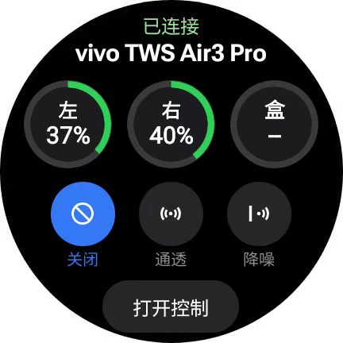

# vivo TWS Watch Control


在 **Wear OS 手表**上直接控制 **vivo / iQOO TWS 耳机**的降噪模式与电量查询——不依赖手机，手表通过经典蓝牙 RFCOMM 直连耳机发送 vivo 私有 GAIA 指令。耳机可同时保持与手机的音频连接（双设备连接）。

- **个人免费开源**，与 vivo 官方无关
- **零数据收集**：不收集、不上传任何数据，无网络权限
- **按"现状"提供**：兼容性可能随耳机固件更新而变化
- **严禁商业倒卖**：仅供非商业学习交流，禁止打包收费或在闲鱼/淘宝等平台售卖

> ⚠️ **非官方、未获授权**：本项目为非商业个人学习研究作品，未获 vivo / 三星 / 高通 / 蓝牙技术联盟任何授权与关联认证；文中出现的第三方商标仅作兼容性说明（名义性合理使用），归各自所有者所有。协议基于开源社区公开逆向成果（见致谢），由作者借助 AI 辅助完成 Wear OS 端开发与实机调试。

## ✨ 功能

- **噪声控制三选一**：降噪开 / 降噪关 / 通透，当前模式高亮（适配圆形表盘的深色卡片式 UI）
- **系统卡片（磁贴）**：表盘滑页即达——连接状态 + 三个电量环 + 降噪三档直切 + 打开控制入口，数据变化自动刷新
- **三段电量显示**：左耳 / 右耳 / 充电盒百分比 + 彩色进度条（绿正常、红低电量、⚡️充电中、`--` 未上报）
- **DeepX 音效五档**（开发者设置）：标准 / 清澈人声 / 超重低音 / 清亮高音 / 悠扬听书循环切换；前三档真机验证，后两档按官方顺序推断
- **空间音频开关**（开发者设置·实验性）：作者感觉无效，请勿依赖；指令链路已打通（首次启用弹独立风险确认框，记住后不再打扰），仅限 vivo TWS Air 3 Pro；开发者设置默认隐藏，每次启动重新关闭，连点 5 下"开发者设置"入口开启
- **智能连接与省电**：切后台自动断开省电，回前台自动重连；耳机断开（开关机/超距）时电量显示自动清空并自动重连恢复，页面内也可手动刷新
- **首次启动安全确认**：每个新版本首次打开都需阅读并确认免责与佩戴安全提示（同版本只确认一次）

## 📱 支持的手表

- **实测机型**：三星 Galaxy Watch7（SM-L300，Wear OS / Android 16）——本项目在这台手表上完成实机验证
- **其他 Wear OS 手表**：满足 Wear OS 3+ 且支持经典蓝牙（RFCOMM/SPP）理论上可用，但本项目未逐一验证，不做保证

## 🎧 支持的耳机

vivo / iQOO TWS 家族（TWS 3 代起）共用一套 GAIA 私有协议，App 按蓝牙设备名自动选择机型配置（含 `air3` → Air3 Pro 配置；含 `3e` / `tws3` → TWS 3e 配置；其余 → 家族默认 v4，即 TWS 4 的实测配置）：

| 支持度 | 机型 | 依据 |
| :--- | :--- | :--- |
| ✅ 实机验证 | vivo TWS Air3 Pro | 本项目在 Galaxy Watch7 上全功能实测（降噪三态 + 电量 + DeepX） |
| ✅ 来源项目真机验证（非本项目实测） | vivo TWS 3e、TWS 4 / TWS 4 Hi-Fi、TWS 5 | [TWS-Pods-PC](https://github.com/Zhaoyi-ya/TWS-Pods-PC) 真机抓包（3e 全套 + TWS 4 电量/降噪帧）、vivopods-mac 真机验证（TWS 5），命令与本 App 一致 |
| ⚡️ 理论兼容 | vivo TWS 3 / TWS 3 Pro、TWS Air / Air 2 / Air 3、TWS 5e、TWS A1 / A1 Pro、iQOO TWS 1 / Air / Air Pro / Air3 Pro | 同协议画像（[HyperEars](https://github.com/silverpoetry/HyperEars) 零售名录 + [Pods-Protocol-Reverse](https://github.com/Star-ZER0/Pods-Protocol-Reverse) 家族默认配置），配置按代际推断 |
| ❓ 未验证 | vivo TWS Neo / TWS 2 / TWS 2e / 初代 TWS（2020-2021 代次） | 协议代次较早，无公开验证记录，不保证可用 |

**兼容性说明：**

- 理论兼容机型若降噪切换无反应，多半是机型后缀差异，欢迎提 [Issue](../../issues) 注明耳机型号。
- **固件兼容边界**：本 App 不校验耳机固件版本，各机型配置基于特定固件实测（Air3 Pro 为 2026-07 固件）；在固件更新后行为可能偏离，若切换降噪多次无反应，请立即停止使用该功能并提 Issue，勿反复尝试。
- 本 App 连接后主动查询电量/降噪并周期轮询，不依赖"注册通知链"，对两代初始化分支（TWS 4 系发链 / TWS 5 不发链）都适用。
- 非 vivo / iQOO 家族耳机不受支持（协议不同，如 AirPods / Marshall / Sony 等）。

## 🧩 已知问题

- **磁贴状态刷新**（影响 0.3.3 ~ 0.3.5，0.3.6 修复）：耳机断开后，磁贴顶部的"已连接"可能长时间不变化、电量环保持旧值。原因有二：蓝牙底层链路断开后不会立刻消失，连接判断会滞后一段时间；电量环图片被固定的资源版本号缓存。0.3.6 起连接状态以 App 的断连回调为准、资源版本号随电量值变化。若磁贴显示仍异常，可在表盘移除磁贴后重新添加。
- **空间音频开关**：切换后听感无明显变化（作者感觉无效），详见免责声明；该指令链路仍会改变耳机的内部状态，介意的话不要开启。

## 📸 界面




## 🚀 快速开始

1. **手表与耳机完成蓝牙配对**：手表 `设置` → `连接` → `蓝牙` → `配对新设备`（耳机放回充电盒再开盖进入配对模式）。RFCOMM 安全通道要求已配对。
2. **安装 APK（任选其一）**：
   - **免电脑（推荐）**：手机安装 WearOS 工具箱 → 连接手表 → 「安装本地 APK」选择从 [Releases](../../releases) 下载的 APK。
   - **电脑 ADB**：从 [Releases](../../releases) 下载 `vivo-tws-watch-debug.apk`，执行 `adb install -r` 装到手表。
   - **自行构建**：Windows 下依次运行 `scripts\setup-env.bat`（首次，装 JDK17 + Android SDK）→ `scripts\build.bat`（免 Gradle，一键出包）。
3. **授权使用**：手表上打开"vivo 耳机控制"，阅读并同意免责提示，授权"附近设备"权限即用。

## 🔧 协议要点

全部来自社区公开逆向 + 本项目真机探测（完整命令表与探测方法见 [docs/AI_CONTEXT.md](docs/AI_CONTEXT.md)）：

| 层次 | 内容 |
| :--- | :--- |
| 传输层 | 经典蓝牙 RFCOMM；SDP UUID `00000837-d102-11e1-9b23-00025b00a5a5`（高通 GAIA），发现失败退回 channel 13 |
| 帧格式 | `FF \| VERB \| 00 \| LEN \| VENDOR(2B) \| CMD(2B) \| PAYLOAD`；握手/电量 VERB=4，其余控制帧 VERB=3（用错耳机沉默） |
| 厂商 ID | `0x000A`（Qualcomm 通用握手）/ `0x001B`（vivo 命令空间） |
| 降噪 | 设置 `0x0130` / 查询 `0x0230`；payload `[mode, 机型尾缀]`，mode：00 降噪 / 01 关 / 02 通透 |
| 电量 | 查询 `0x0207` / 上报 `0x8207`（恒 VERB=4）；payload `[00, 左, 右, 盒, 充电标志]`，`0xFF`=未上报 |
| DeepX 音效 | 设置 `0x0118` / 查询 `0x0218`；payload 单字节 `[mode]`，真实值 0/1/2/3/5（0x04 被官方跳过） |
| 空间音频 | 设置 `0x0139` / 查询 `0x0239`；`[01]` 开 `[00]` 关；上报 `[00, 状态, 01]`，状态随摘戴自动变化 |

机型差异（降噪设置帧）：Air3 Pro 用 VERB=3 + 尾缀 `04 00`；TWS 3e 用 VERB=3 + 尾缀 `03`；家族默认（=TWS 4）用 VERB=4 + 尾缀 `03 01`。

## 🧠 AI 开发经验文档

[docs/AI_CONTEXT.md](docs/AI_CONTEXT.md) 是这个项目一路踩坑攒下的完整开发经验：协议帧格式与命令总表（哪些实测过、哪些是推断、哪些已证伪）、未知指令怎么用探针法试出来、Wear OS 连接策略、免 Gradle 构建的全部坑、失败档案。

**欢迎大家参考**——想接着开发这个项目，或做类似项目，把这份文档整个复制发给你的 AI，配上文档末尾的引导提示词，它就能直接接手后续开发。

## 🤖 AI 一键傻瓜式操作

不会搭环境也没关系——把下面的提示词整段复制给任意 AI 编程助手（Claude Code / Cursor 等），它会替你完成下载仓库、搭环境、编译、装进手表的全过程：

```text
请帮我把 GitHub 项目 hdzw1155/vivo-tws-watch-control（vivo/iQOO TWS 耳机的
Wear OS 手表控制器）装到我的 Wear OS 手表上，步骤：
1. git clone 该仓库（若直连失败请重试或换镜像）。
2. 检查本机有无 JDK17 与 Android SDK；没有就参考仓库 scripts/setup-env.bat
   自动安装（Windows 下：Microsoft JDK 17 装到 %USERPROFILE%\android-tools，
   Android 命令行工具装到 %LOCALAPPDATA%\Android\Sdk，再装
   platforms;android-34 和 build-tools;34.0.0）。
3. 运行 scripts/build.bat 编译出 vivo-tws-watch-debug.apk（免 Gradle）。
4. 手表开启 开发者选项 → ADB 调试 / 无线调试，用 adb connect 连上手表后
   adb install -r 安装。
5. 先在手表蓝牙设置里与耳机配对，再打开手表上的"vivo 耳机控制"，
   验证降噪三态切换和电量显示，出问题按仓库 README 排查。
注意：.bat 脚本需要 CRLF 换行和 chcp 65001，路径含空格时注意加引号。
```

## 🙏 致谢与协议来源

本项目的核心协议参数、指令帧格式与机型配置直接建立在以下开源前辈与社区项目的无私分享之上，特此致谢：

- **[silverpoetry/HyperEars](https://github.com/silverpoetry/HyperEars)** — vivo/iQOO TWS 家族协议画像、零售机型名录、Air 3 Pro 实机抓包记录与三套机型线格式配置（WireConfig），本 App 的多机型参数直接源自该项目。
- **[Zhaoyi-ya/TWS-Pods-PC](https://github.com/Zhaoyi-ya/TWS-Pods-PC)** — vivo TWS 私有协议逆向文档（`vivo/PROTOCOL.md`）：3e 全套实测、TWS 4 真机抓包、TWS 5 交叉验证、机型差异与 btsnoop 抓包方法论。
- **[Star-ZER0/Pods-Protocol-Reverse](https://github.com/Star-ZER0/Pods-Protocol-Reverse)** — vivo TWS 公共协议画像（家族默认参数来源）。
- **OPPO-Pods-For-Windows**（C# 实现，覆盖 TWS 4 系 / Air3 Pro / TWS 3e）与 **vivopods-mac**（macOS，TWS 5 验证）——同族协议的多平台独立实现，交叉印证了命令空间。
- Qualcomm GAIA 框架的公开文档与 [c0ffee-audio/marshall-protocol](https://github.com/c0ffee-audio/marshall-protocol) 等项目提供的 GAIA 帧格式参照。

## 📢 授权与声明 (License & Permissions)

本项目的底层协议参数源自上述开源社区前辈的研究成果；本项目作者主要负责 **Wear OS 手表端的代码实现、UI 交互适配、连接状态管理、真机调试及文档整理**。

为尊重上游开源作者的劳动成果，并防止不良商家将社区免费成果打包倒卖，本项目在 [MIT License](LICENSE) 基础上补充以下使用声明与约定：

### 1. 个人学习与非商业使用（完全免费）

- 本项目完全免费提供给任何个人、爱好者用于学习、研究、测试及非商业用途。
- 欢迎任何人基于本项目进行 Fork、修改和提交 PR，共建社区。
- 如果你在开发中参考或使用了本项目的 Wear OS 端代码或文档，请务必保留版权声明并注明来源（附上本仓库链接）；若使用了底层的耳机协议参数，也请一并署名致谢上述上游开源项目。

### 2. 严禁商业倒卖（拒绝"二道贩子"）

- **严禁私自售卖**：严禁任何个人或团队将本项目的源代码、编译后的 APK 安装包直接打包收费，或在闲鱼、淘宝、拼多多、付费社群及各类应用商店进行二次售卖、付费代装。这既是对作者心血的盗用，也是对整个上游开源社区无私分享精神的背叛。
- **第三方闭源商用限制**：任何非官方的第三方商业团队，未经许可不得将本项目的代码直接抹去署名并集成至商业盈利产品中。如发现抹除署名、冒充原创或恶意倒卖等行为，作者保留发起平台下架投诉（DMCA）及公开谴责等维权权利。

### 3. 官方与厂商（欢迎采纳，请保留引用署名）

- 作者非常欢迎正规厂商与组织（如 vivo / iQOO 等）的工程师参考、借鉴或直接在官方产品中采纳本项目的 Wear OS 端实现代码与交互逻辑，以造福广大手表用户。
- 官方团队**无需专门联系作者申请授权**：按照 MIT 开源协议直接引用即可，只需在开源致谢或说明中保留来源署名——不抹除版权与致谢信息，拒绝无署名"白嫖"。

## ⚠️ 免责与安全声明

**佩戴与操作安全提示**：首次连接新机型、耳机固件升级后首次使用或开启实验性功能时，**请先将耳机取下（切勿佩戴入耳）并将音量调至最低进行测试**，确认无异常爆音或高频啸叫后再佩戴。请勿在驾驶、骑行或操作机械等需要集中注意力的场景下操作本软件或切换降噪模式。

**责任限制**：作者未观察到硬件损坏案例，但不保证兼容性和安全性；私有指令可能随固件更新失效，使用风险自担。本项目为第三方非官方社区工具，仅供个人学习研究和技术交流，与 vivo 及其关联公司无任何关联，未获得其授权或背书。项目按"现状（AS IS）"提供，不提供任何明示或暗示担保，包括适销性、特定用途适用性和不侵权担保。使用本软件可能导致连接异常、功能失效、保修失效或违反第三方服务条款。使用者应自行评估并承担使用风险。作者不对因使用或无法使用本软件造成的设备损坏、数据丢失、利润损失或第三方索赔承担责任，但法律强制规定不得排除的责任除外。vivo 等商标归其权利人所有，仅作兼容性说明。如权利人认为本项目侵犯其合法权益，请联系作者，作者将及时处理。

**实验性功能（开发者设置区）免责**：空间音频等实验功能指令来自社区反编译推断并以真机探测校准，仅限 vivo TWS Air 3 Pro 验证，其他耳机不一定适配；首次启用会弹出个别化风险确认框（确认后记住，不再重复弹出）；切换瞬间音效可能发生突变（音量/空间感骤变），调试前请先摘下耳机并调低播放音量，因此造成的不适由使用者自行承担。

**数据边界**：本 App 不收集、不上传、不分析任何用户数据，无网络访问权限；相关数据合规义务（PIPL / 数安法 / 网安法）因零数据收集而不触发。若后续版本引入任何数据收集功能，将另行披露并更新本声明。
